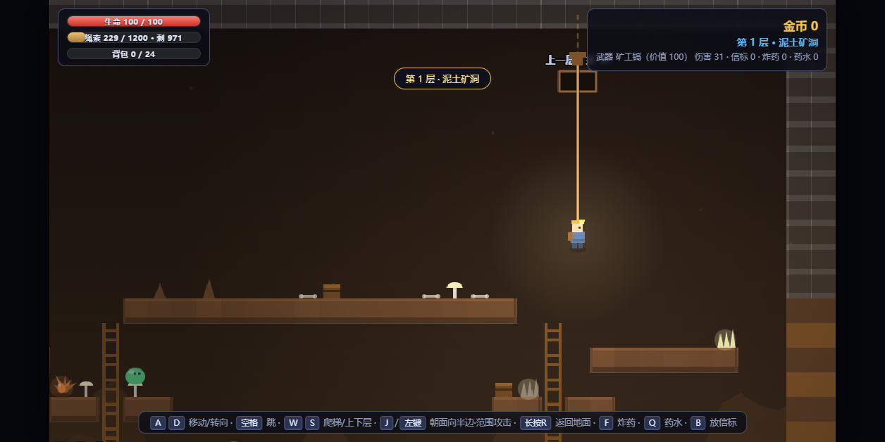
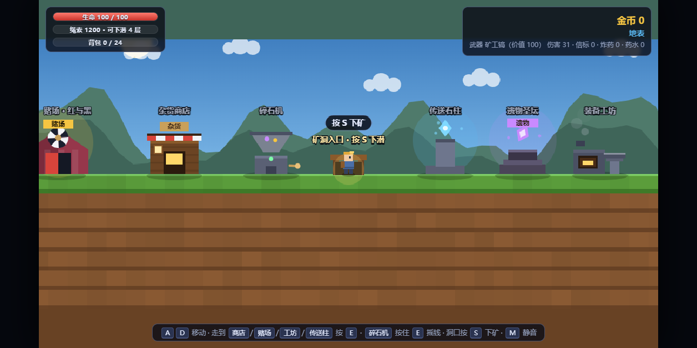
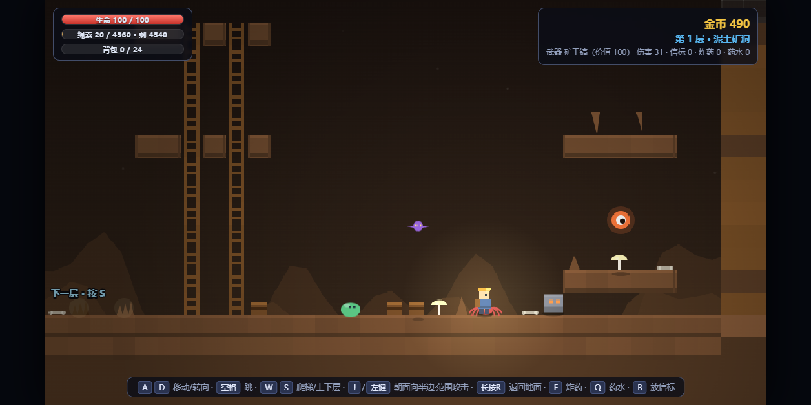
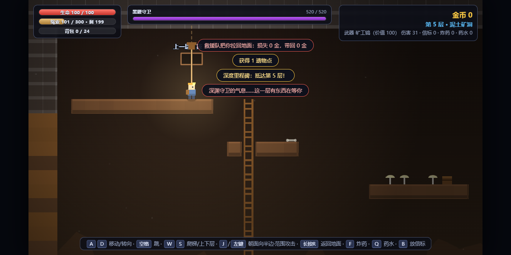
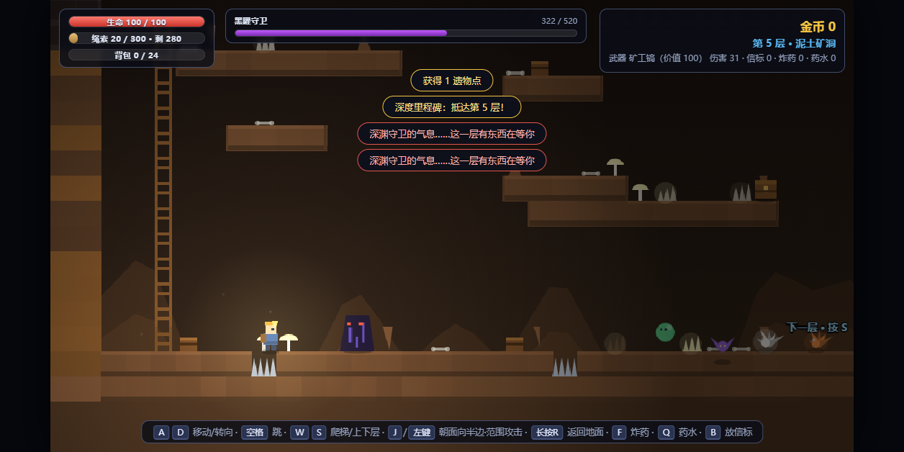
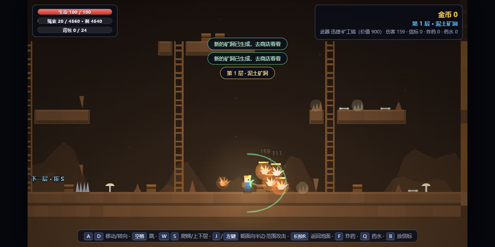
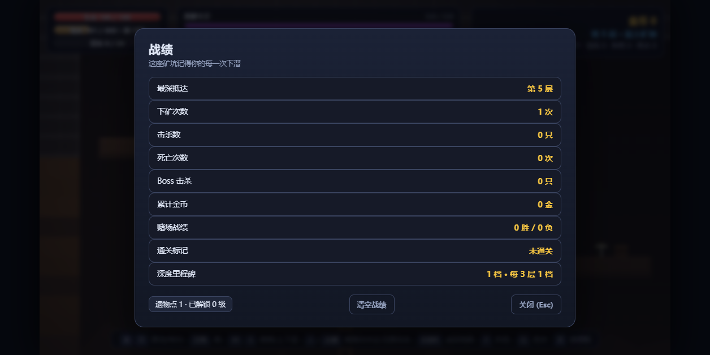
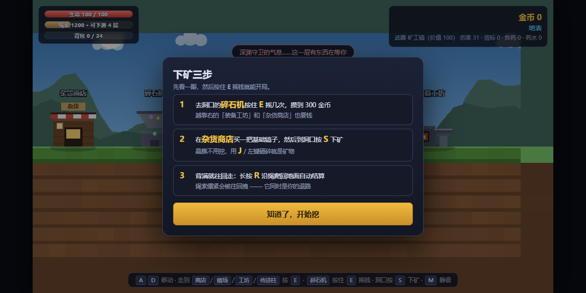
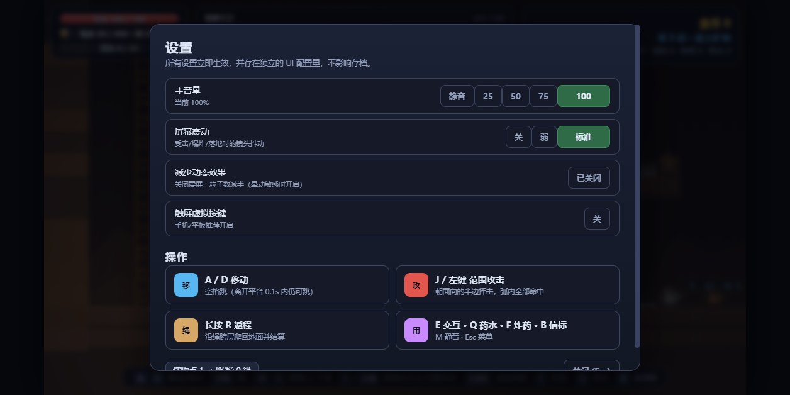
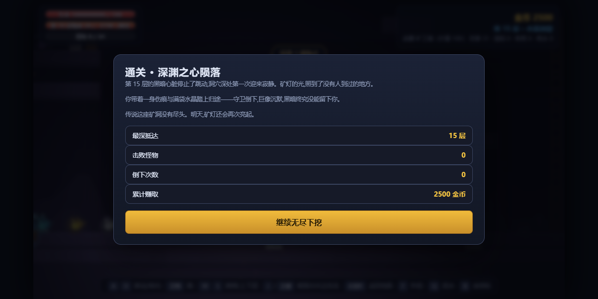

# 深岩矿洞 · 箱庭之下

> 单文件 HTML5 Canvas 2D 挖矿 Roguelite —— **双击 `index.html` 就能玩**，零依赖、零构建、零外部资源。

地表攒钱 → 下潜砸晶簇 → 背满沿绳返回结算 → 用赚来的金币换更长的绳子和更强的镐，再去更深的地方。
一层一个箱庭，每 5 层一场 Boss，第 15 层的「深渊之心」是终点。



`单文件 3142 行` · `零外部依赖` · `程序化绘制 + 可替换贴图` · `键鼠 / 触屏` · `MIT`

---

## 快速开始

```text
1. 下载仓库
2. 双击 index.html
```

没有 npm、没有打包、没有后端。想手机玩就把 `index.html` 拷进手机直接打开（横屏）。

> 外置怪物贴图放在 `assets/mob/`。**删掉整个目录也能正常玩** —— 缺图时游戏自动回退到代码里的程序化绘制。

---

## 玩法

### 核心循环

```text
[地表] 碎石机摇钱 → 商店买镐 / 工坊升级 / 赌场搏一把
   │
   ├─ 走到洞口按 S 下矿
   │
[地下] 砸晶簇怪拿矿物 · 打怪 · 开宝箱 · 找下潜井
   │      绳索锚在当层入口，跨层累计扣长度 —— 绷紧就把你往回拽
   │
   ├─ 长按 R 沿绳跨层爬回地面 → 自动结算
   │
[更深] 金币换「登山绳」拉长绳长 → 下得更深 → 每 5 层 Boss
```

**绳索是命脉**：它既是你的退路，也是绳子会用完的硬性下潜上限。装备不够就往下冲，只会被绳子拽回去。

### 地表设施

| 设施 | 作用 |
|---|---|
| 碎石机 | 按住 `E` 手摇保底金币（开局就拿它攒第一桶金） |
| 杂货商店 | 只卖基础武器，价值 100 起 |
| 装备工坊 | 升级登山绳 / 背包 / 生命等 |
| 赌场 · 红与黑 | 押金币翻倍或清零 |
| 传送石柱 | 用「传送信标」标记层数后，一键直达那一层（消耗绳索） |
| 遗物圣坛 | 用遗物点解锁**跨局永久**强化（Boss 击杀、每 3 层里程碑、稀有宝箱产出） |

### 战斗

- 武器 = `{底子, 价值}`：**伤害随价值线性增长**，跨过挡位解锁攻击距离或特效。
- **矿物就是不会动的「晶簇怪」**，和怪一样用武器砸碎即得矿物。
- 范围攻击朝面向的半边挥出，弧内全部命中。
- `Q` 药水 · `F` 炸药 · `B` 信标（回程标记）。

### 深处与失败

- 每 **5 层**一场 Boss：黑曜守卫 → 岩核巨像 → **深渊之心**（第 15 层，通关）。
- **死亡丢一半背包**：损失的一半直接丢弃，幸存的一半在被打捞回地面时兑成金币；金币、遗物点与地表升级保留。
- 通关后 `G.st.won` 置位并弹出胜利面板。

---

## 操作

| 键位 | 作用 |
|---|---|
| `A` / `D` | 左右移动 |
| `空格` | 跳跃（离开平台 0.1s 内仍可起跳） |
| `J` / 鼠标左键 | 范围攻击 |
| `E` | 交互（摇碎石机、买东西、下矿） |
| `S` | 在洞口下矿 |
| 长按 `R` | 沿绳返程，跨层爬回地面并结算 |
| `Q` / `F` / `B` | 药水 / 炸药 / 信标 |
| `M` | 静音 |
| `Esc` | 菜单 / 关闭面板 |

触屏：设置里打开**触屏虚拟按键**，屏幕下方会出现移动、跳跃、攻击与交互按钮，并按安全区适配。

---

## 截图

| 地表 | 洞内 |
|---|---|
|  |  |

| Boss | Boss 血条（全屏宽度级） |
|---|---|
|  |  |

| 范围攻击 | 返程结算 |
|---|---|
|  |  |

| 首次引导（只出现一次） | 设置面板 |
|---|---|
|  |  |



---

## 工程要点

- **单文件交付**：全部逻辑、样式、程序化绘制都在 `index.html`，双击即玩，引 PNG/Atlas 会破坏这一核心属性，因此本项目不接图片生成链路（理由写在 `specs/deep-cave/research.md`）。
- **一层一个箱庭**：固定尺寸的小场景模板化生成、素材复用、按深度切换主题色调，保证手感和性能都可预期。
- **世界用 Canvas，界面用 DOM**：Canvas 逻辑分辨率固定 `1024 × 576`、`TILE = 32`；HUD / 面板 / Boss 血条一律 DOM + CSS 变量渲染，避免与 Canvas 缩放比打架。
- **设计 Token 契约**：颜色、圆角、字号、层级全部走 `var(--*)`，契约见 `specs/deep-cave/contracts/`。层级固定为
  `hud 10 < bossbar 12 < toast 13 < touch 15 < fade 18 < modal 20`。
- **可替换贴图 + 程序化回退**：`assets/mob/*.png` 是横向多帧动画带，换成自己的图就生效，缺图自动回退（详见 [assets/mob/README.md](assets/mob/README.md)）。
- **无障碍**：`减少动态效果`（震屏归零 + 粒子减半）、`屏幕震动` 开关、`主音量`、触屏按键；首次引导只出现一次且**不阻断游戏**。
- **设置与存档分离**：UI 配置存在独立 key `deepcave_ui`，不污染存档。
- **固定种子的随机**：层生成用 `mulberry32(seed ^ n)`，同一层重进布局一致。

## 目录结构

```text
deep-cave/
├── index.html                 整个游戏（单文件）
├── assets/
│   └── mob/                   外置怪物贴图（可整个删除）
│       ├── README.md          贴图格式 / 替换 / 重新烘焙规则
│       └── *.png
├── specs/deep-cave/           设计文档
│   ├── spec.md                玩法→UI 规则映射、平台、验收标准
│   ├── plan.md                屏幕路线与批次
│   ├── tasks.md               任务清单与待办
│   ├── research.md            7 项实测缺陷（含测量数据）
│   └── contracts/             设计 Token / 屏幕契约（YAML）
└── screenshots/               README 用截图
```

## 设计文档

界面轮次的完整过程留在了 `specs/deep-cave/`：先做 Token 契约，再把 Boss 血条从 Canvas 迁到 DOM（原本会压住 toast）、HUD 改 flex 行、HUD 文案数字优先、新增设置屏与一次性引导。
最终 `169 项 CDP 断言全过、控制台 0 错误`。

## 已知限制

- 只适配**横屏 16:9**，竖屏不做适配。
- 设置面板内容略高于可视区，需滚动到底部按钮（`.card{overflow:auto}` 已兜住，不阻断操作）。
- `codex` 图鉴屏未实现（见 `specs/deep-cave/tasks.md` 待办）。
- CDP 回归测试脚手架未随仓库发布（它依赖本机 Chrome + 硬编码路径），仓库只保留源码、文档与截图。

## 许可

[MIT](LICENSE) © 2026 DGGK2333
